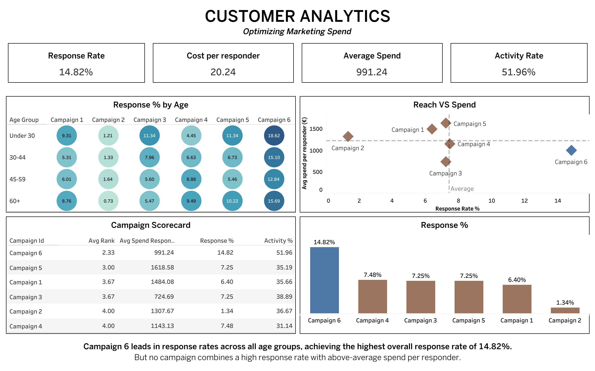

# Marketing Campaign Analysis: 

An end-to-end analytics project comparing six marketing campaigns on **response rate**, **spend per responder** and **customer activity**, ending in a budget recommendation. Built with Python (pandas), MySQL and Tableau Public.

**Live dashboard:** [Tableau Public](https://public.tableau.com/views/Campaigns-PerformanceAnalytics/Dashboard1)



## Business question

How can the company improve customer campaign response while optimizing marketing spend?

The company ran six campaigns against the same customer base. This project compares them on reach (how many customers respond) and value (how much those responders spend) to show where extra budget would work hardest.

## Key findings

- **Campaign 6 has the highest response rate (14.82%)**, roughly double any other campaign, and it leads in every age group (12.8% to 18.6%).
- **Campaign 5 has the highest spend per responder (about 1,619)**, but responds at only 7.25%.
- **No campaign wins on both.** Campaign 6's responders spend less (about 991) than the responders of Campaigns 5, 1 and 2.
- Combined rank across response rate, spend per responder and 30-day activity: **Campaign 6 (2.33)**, Campaign 5 (3.00), Campaigns 1 and 3 (3.67), Campaigns 2 and 4 (4.00).
- **Recommendation:** Campaign 6 is the best trade-off for extra budget, with the caveats below.

## Caveats and assumptions

The dataset has no campaign dates, response dates, purchase dates or real costs, so some metrics are proxies:

- **Cost per responder** uses an assumed flat contact cost of 3 (the dataset's `Z_CostContact`), so it is `3 / response rate`. It carries the same signal as response rate and is not independent evidence.
- **30-day activity rate** is the share of responders whose `Recency` is 30 days or less. It is inflated for Campaign 6, the most recent campaign.
- **Revenue per response** uses a flat 11 (`Z_Revenue`). Its meaning is not documented, so total revenue was not used for the decision.
- Customer spend is the sum of the six `Mnt*` product columns, which covers a two-year period and is not tied to a campaign.

## Project structure

```
Marketing Campaign analytics/
├── Data/
│   ├── marketing_campaign.csv        # raw Kaggle data, NOT in repo (download, see below)
│   ├── marketing_campaign.xlsx       # raw Kaggle data, NOT in repo (download, see below)
│   └── marketing_campaign_clean.csv  # output of the cleaning notebook
├── notebook/
│   └── data_cleaning.ipynb           # pandas cleaning steps
├── sql/
│   ├── marketing_db_creation.sql     # database and 5-table schema
│   ├── marketing_db_datainsert.sql   # loads the tables from the staging table
│   └── marketing_db_analysis.sql     # analysis questions Q1 to Q5
├── Tableau/                          # query results exported for the dashboard
│   ├── response_rate.csv         # Q1
│   ├── responders_avgspend.csv   # Q2b
│   ├── responders_activity_rate.csv  # Q3
│   ├── demographics.csv              # Q4
│   └── rank.csv                      # Q5
└── README.md
```

## Method

### 1. Data cleaning (pandas)

Source: the Kaggle *Marketing Campaign* dataset (2,240 customers). See `notebook/data_cleaning.ipynb`.

- Read with `sep=';'` (the file is semicolon-separated).
- `Income`: 24 missing values filled with the median; one extreme outlier (666,666) replaced with the median.
- `Year_Birth`: three implausible values (people over 100 at enrolment) replaced with the median birth year.
- Created `Age_Enrolled` = enrolment year minus birth year.
- `Marital_Status`: kept the five valid categories (Married, Together, Single, Divorced, Widow) and dropped 7 rows with invalid values. **2,233 customers remain.**
- `Education`: standardized to a smaller set ("2n Cycle" and "Master" become Masters, "Graduation" becomes Bachelors).

### 2. Database (MySQL)

The flat file is split into five tables: `customers`, `campaigns`, `channels`, `responses` and `purchases`. `responses` has one row per customer per campaign (reshaped from wide to long with `UNION ALL`). Campaign constants (cost, revenue) live in `campaigns`, since they describe the campaign and not the response.

### 3. Analysis (SQL)

| # | Question | Techniques |
|---|----------|-----------|
| Q1 | Response rate by campaign | JOIN, GROUP BY |
| Q2 | Revenue by campaign, and avg spend of responders | JOIN, aggregate |
| Q3 | Share of responders active in the last 30 days | Boolean sums |
| Q4 | Response rate by age group and campaign | CASE, multi-column GROUP BY |
| Q5 | Campaign scorecard with ranks | CTEs, window functions (`RANK() OVER`) |

### 4. Dashboard (Tableau Public)

KPI tiles for Campaign 6, an age-group by campaign heatmap, a reach vs spend scatter, a scorecard table and a response-rate bar chart. Tableau Public cannot connect to MySQL, so query results were exported to CSV.

## How to reproduce

1. Download the dataset from [Kaggle](https://www.kaggle.com/datasets/rodsaldanha/arketing-campaign/data) and save `marketing_campaign.csv` in `Data/`.
2. Run `notebook/data_cleaning.ipynb` to produce `Data/marketing_campaign_clean.csv`.
3. Import the clean CSV into MySQL as a staging table named `marketing_staging`.
4. Run the SQL scripts in order: `marketing_db_creation.sql`, `marketing_db_datainsert.sql`, `marketing_db_analysis.sql`.
5. Export the query results and connect them in Tableau.

Tools: Python 3.11, pandas, JupyterLab, MySQL 8 and Workbench, Tableau Public.

## Limitations and next steps

- Add campaign dates and response dates to compute a proper retention window instead of the recency proxy.
- Add real campaign costs to replace the flat assumption.
- Add purchase dates to measure true repeat purchase after a campaign.
- Extend the demographic analysis (income bands, education, marital status).

## Data source

[Marketing Campaign dataset](https://www.kaggle.com/datasets/rodsaldanha/arketing-campaign/data) by rodsaldanha on Kaggle. Dataset license: "Other", with the terms given in the dataset description on Kaggle. The raw data files are not included in this repository; download them from the link above.

## Author

Sree. Data Analytics with AI bootcamp, WBS Coding School.
[LinkedIn](https://linkedin.com/in/sree-malathik)
